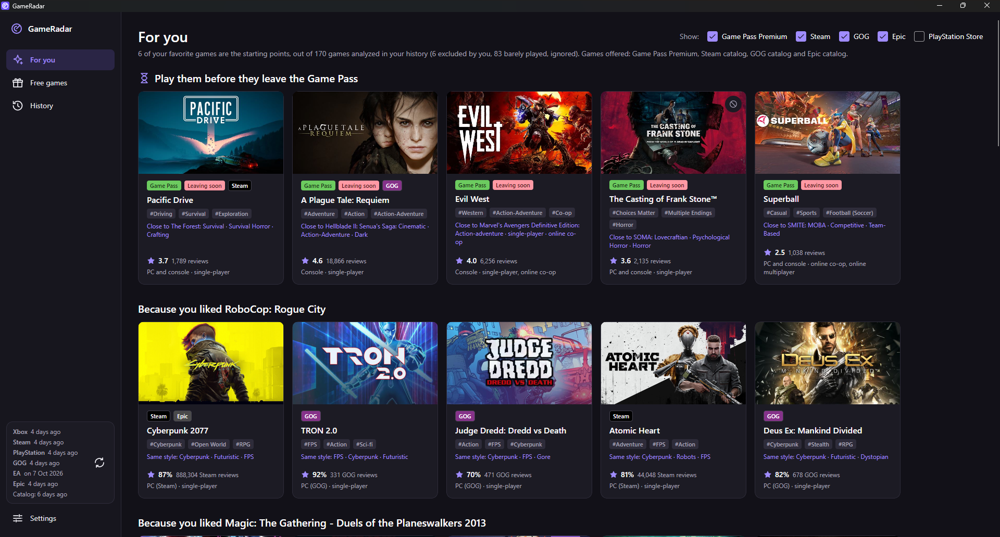
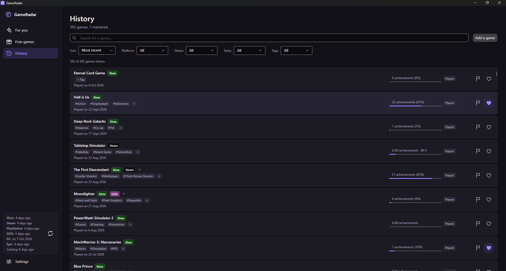
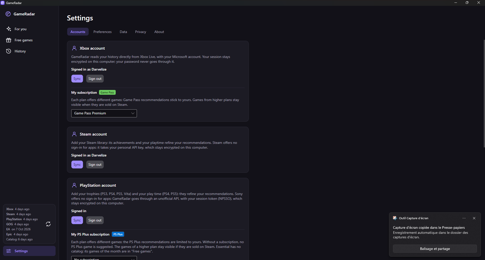
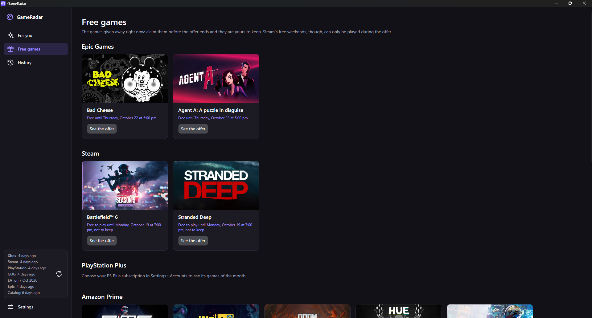
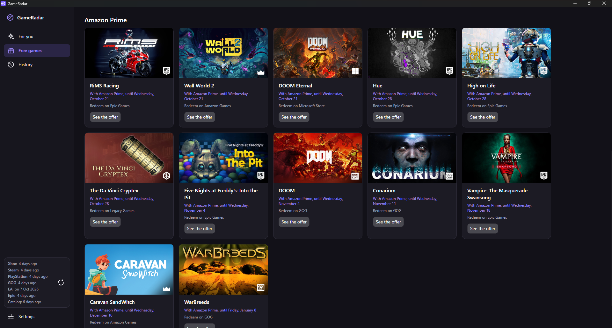

# GameRadar

<p align="center">
  <a href="docs/screenshots/for-you.png"></a>
  <a href="docs/screenshots/history.png"></a>
  <a href="docs/screenshots/settings.png"></a>
  <br>
  <a href="docs/screenshots/free-game1.png"></a>
  <a href="docs/screenshots/free-game2.png"></a>
</p>

**English** · [Français plus bas](#francais)

A Windows app that recommends games based on what you really played: games finished, 100%-completed, playtime on Xbox, Steam, PlayStation, GOG, EA and Epic. It picks from **your** Game Pass or PS Plus plan, or from the Steam, GOG, Epic and PlayStation Store best sellers. A **Free games** page also lists what Epic, Steam, PS Plus and Amazon Prime give away right now.

A personal project: free, no ads, no account, no server. The code is right here, under the [MIT](LICENSE) license.

## Download

[**Latest version**](../../releases/latest) → `GameRadar.exe` (Windows 10/11, 64-bit). A single file, nothing to install.

On first launch, Windows shows "Windows protected your PC": **More info** → **Run anyway**. The warning appears because the exe isn't signed (a certificate is expensive for a free project), not because anything was detected.

## Your data stays on your PC

- Everything is in `%LOCALAPPDATA%\GameRadar`. Sessions and the Steam key are encrypted by Windows ([`SecretStore.cs`](src/GameRadar.Core/Settings/SecretStore.cs)).
- GameRadar has no server: it talks to the platforms directly, nothing goes through me.
- The error log hides every secret ([`ErrorLog.cs`](src/GameRadar.Core/Logging/ErrorLog.cs)).
- **Settings › Privacy**: links to remove its access to your accounts, and a button to erase everything.

Sites contacted, only for the accounts and catalogs you use:

| For | Domains |
|---|---|
| Xbox, Game Pass | `login.microsoftonline.com`, `*.xboxlive.com`, `catalog.gamepass.com`, `displaycatalog.mp.microsoft.com` |
| Steam | `api.steampowered.com`, `store.steampowered.com` |
| PlayStation, PS Plus | `ca.account.sony.com`, `*.np.playstation.com`, `www.playstation.com`, `store.playstation.com` |
| EA | `service-aggregation-layer.juno.ea.com` |
| Epic | `*.epicgames.com` |
| GOG | `www.gog.com`, `catalog.gog.com` |
| Free games (Amazon Prime) | `luna.amazon.com` (no account) |
| Updates | `api.github.com` (one request at startup, no personal data) |
| Covers | the image servers of those same stores |

You can check it with your firewall or Wireshark.

## Connecting your accounts

In **Settings › Accounts**. All optional: with no account, add your games by hand (**History › Add a game**).

- **Xbox**: Microsoft sign-in in your browser; GameRadar never sees your password. Microsoft shows "unverified publisher": verification is only open to companies.
- **GOG**: your profile name; the profile must be public. No sign-in, no key.
- **Steam**: your profile address (game details set to **Public**) and an API key created at [steamcommunity.com/dev/apikey](https://steamcommunity.com/dev/apikey) (domain: `localhost`). GameRadar only uses it to read your library, achievements and playtime ([`SteamClient.cs`](src/GameRadar.Core/Steam/SteamClient.cs)).
- **PlayStation, EA, Epic**: you copy a code from their official website, opened in your browser.

### Why copy a code?

Sony, EA and Epic don't let independent apps sign in the way Microsoft does. Copying a code is the only way. Here you can check what happens to it:

- the PlayStation code is encrypted on your PC and only sent to Sony ([`PlayStationAuth.cs`](src/GameRadar.Core/PlayStation/PlayStationAuth.cs));
- the EA token is never saved; it expires after 4 hours ([`EaClient.cs`](src/GameRadar.Core/EA/EaClient.cs));
- the Epic code is used once, then the session stays encrypted on your PC ([`EpicAccount.cs`](src/GameRadar.Core/Epic/EpicAccount.cs)).

## How it recommends

- **Progress counts, not launching.** A game finished or 100%-completed weighs a lot; a game launched for 10 minutes doesn't count.
- **It compares the style of games** using Steam players' tags: liking *Warframe* leads to *Borderlands*, not *Call of Duty*.
- **"Because you liked X"** sections, and at the top the games leaving your Game Pass soon.
- In the History, you can tick "Story finished" or remove a game you didn't enjoy from your taste.

## Checking the exe

Each exe is built by GitHub Actions from this code ([`release.yml`](.github/workflows/release.yml)), never on my PC. GitHub signs its provenance:

```
gh attestation verify GameRadar.exe -R Darvelize/game-radar
```

Each release also gives the file's SHA-256 and its VirusTotal scan.

## Building it yourself

With the [.NET 10 SDK](https://dotnet.microsoft.com/download):

```
dotnet test
dotnet publish src/GameRadar.App -p:PublishProfile=win-x64   # → publish/GameRadar.exe
```

`src/GameRadar.Core` holds the logic (one folder per platform, the engine in `Services/`), `src/GameRadar.App` the UI ([Avalonia](https://avaloniaui.net/)) and `tests/` the tests (no network, no real data).

## Something wrong?

Open an [issue](../../issues). **Settings › About › Error log** opens the log: it holds no secret, you can attach it.

## License and trademarks

Code under the [MIT](LICENSE) license. The app has its [terms of use](legal/LICENSE.txt): provided as is, without warranty. Component licenses: [THIRD-PARTY-NOTICES.txt](legal/THIRD-PARTY-NOTICES.txt).

GameRadar uses undocumented services that may change without notice. It is an independent project, not affiliated with nor endorsed by Microsoft Corporation, Valve Corporation, Sony Interactive Entertainment, GOG sp. z o.o., Electronic Arts Inc., Epic Games, Inc. or Amazon.com, Inc. Xbox and Game Pass are trademarks of Microsoft Corporation; Steam, of Valve Corporation; PlayStation and PlayStation Plus, of Sony Interactive Entertainment; GOG and GOG.com, of GOG sp. z o.o.; EA and EA Play, of Electronic Arts Inc.; Epic Games and Epic Games Store, of Epic Games, Inc.; Amazon, Prime and Luna, of Amazon.com, Inc. or its affiliates. Game covers and names belong to their publishers.

---

<a id="francais"></a>

# GameRadar (Français)

Une appli Windows qui te recommande des jeux d'après ce que tu as vraiment joué : jeux finis, platinés, temps de jeu sur Xbox, Steam, PlayStation, GOG, EA et Epic. Elle pioche dans **ton** palier Game Pass ou PS Plus, ou dans les meilleures ventes Steam, GOG, Epic et PlayStation Store. Une page **Jeux gratuits** montre aussi ce qu'Epic, Steam, PS Plus et Amazon Prime offrent en ce moment.

Projet perso, gratuit, sans pub, sans compte, sans serveur. Le code est ici, sous licence [MIT](LICENSE).

## Télécharger

[**Dernière version**](../../releases/latest) → `GameRadar.exe` (Windows 10/11, 64 bits). Un seul fichier, rien à installer.

Au premier lancement, Windows affiche « Windows a protégé votre ordinateur » : **Informations complémentaires** → **Exécuter quand même**. L'avertissement vient de ce que l'exe n'est pas signé (un certificat coûte cher pour un projet gratuit), pas d'un problème détecté.

## Tes données restent sur ton PC

- Tout est dans `%LOCALAPPDATA%\GameRadar`. Les sessions et la clé Steam sont chiffrées par Windows ([`SecretStore.cs`](src/GameRadar.Core/Settings/SecretStore.cs)).
- GameRadar n'a pas de serveur : il parle directement aux plateformes, rien ne passe par moi.
- Le journal des erreurs masque tout secret ([`ErrorLog.cs`](src/GameRadar.Core/Logging/ErrorLog.cs)).
- **Réglages › Confidentialité** : liens pour retirer l'accès à tes comptes, bouton pour tout effacer.

Sites contactés, seulement pour les comptes et catalogues que tu utilises :

| Pour | Domaines |
|---|---|
| Xbox, Game Pass | `login.microsoftonline.com`, `*.xboxlive.com`, `catalog.gamepass.com`, `displaycatalog.mp.microsoft.com` |
| Steam | `api.steampowered.com`, `store.steampowered.com` |
| PlayStation, PS Plus | `ca.account.sony.com`, `*.np.playstation.com`, `www.playstation.com`, `store.playstation.com` |
| EA | `service-aggregation-layer.juno.ea.com` |
| Epic | `*.epicgames.com` |
| GOG | `www.gog.com`, `catalog.gog.com` |
| Jeux gratuits (Amazon Prime) | `luna.amazon.com` (sans compte) |
| Mises à jour | `api.github.com` (une requête au démarrage, sans donnée personnelle) |
| Jaquettes | les serveurs d'images de ces mêmes boutiques |

Tu peux le vérifier avec ton pare-feu ou Wireshark.

## Connecter tes comptes

Dans **Réglages › Comptes**. Tous sont facultatifs : sans compte, ajoute tes jeux à la main (**Historique › Ajouter un jeu**).

- **Xbox** : connexion Microsoft dans ton navigateur, GameRadar ne voit jamais ton mot de passe. Microsoft affiche « éditeur non vérifié » : la vérification est réservée aux entreprises.
- **GOG** : le nom de ton profil, qui doit être public. Ni connexion ni clé.
- **Steam** : l'adresse de ton profil (détails des jeux en **Public**) et une clé API créée sur [steamcommunity.com/dev/apikey](https://steamcommunity.com/dev/apikey) (domaine : `localhost`). GameRadar s'en sert seulement pour lire ta bibliothèque, tes succès et ton temps de jeu ([`SteamClient.cs`](src/GameRadar.Core/Steam/SteamClient.cs)).
- **PlayStation, EA, Epic** : tu copies un code depuis leur site officiel, ouvert dans ton navigateur.

### Pourquoi copier un code ?

Sony, EA et Epic ne permettent pas aux applis indépendantes de se connecter comme Microsoft le fait. Copier un code est la seule voie. Ici, tu peux vérifier ce qui en est fait :

- le code PlayStation est chiffré sur ton PC et n'est envoyé qu'à Sony ([`PlayStationAuth.cs`](src/GameRadar.Core/PlayStation/PlayStationAuth.cs)) ;
- le jeton EA n'est jamais enregistré : il expire au bout de 4 h ([`EaClient.cs`](src/GameRadar.Core/EA/EaClient.cs)) ;
- le code Epic sert une seule fois, puis la session reste chiffrée sur ton PC ([`EpicAccount.cs`](src/GameRadar.Core/Epic/EpicAccount.cs)).

## Comment il recommande

- **La progression compte, pas le lancement.** Un jeu fini ou platiné pèse lourd ; un jeu lancé 10 minutes ne compte pas.
- **Il compare le style des jeux** avec les tags des joueurs Steam : aimer *Warframe* mène à *Borderlands*, pas à *Call of Duty*.
- **« Parce que tu as aimé X »**, et en tête les jeux qui quittent bientôt ton Game Pass.
- Dans l'Historique, tu peux cocher « Histoire finie » ou retirer de tes goûts un jeu que tu n'as pas aimé.

## Vérifier l'exe

Chaque exe est compilé par GitHub Actions à partir de ce code ([`release.yml`](.github/workflows/release.yml)), jamais sur mon PC. GitHub en signe la provenance :

```
gh attestation verify GameRadar.exe -R Darvelize/game-radar
```

Chaque release donne aussi le SHA-256 du fichier et son analyse VirusTotal.

## Compiler soi-même

Avec le [SDK .NET 10](https://dotnet.microsoft.com/download) :

```
dotnet test
dotnet publish src/GameRadar.App -p:PublishProfile=win-x64   # → publish/GameRadar.exe
```

`src/GameRadar.Core` contient la logique (un dossier par plateforme, le moteur dans `Services/`), `src/GameRadar.App` l'interface ([Avalonia](https://avaloniaui.net/)) et `tests/` les tests (sans réseau ni données réelles).

## Un souci ?

Ouvre une [issue](../../issues). **Réglages › À propos › Journal des erreurs** ouvre le journal : il ne contient aucun secret, tu peux le joindre.

## Licence et marques

Code sous licence [MIT](LICENSE). L'appli a ses [conditions d'utilisation](legal/LICENSE.txt) : fournie telle quelle, sans garantie. Licences des composants : [THIRD-PARTY-NOTICES.txt](legal/THIRD-PARTY-NOTICES.txt).

GameRadar utilise des services non documentés qui peuvent changer sans prévenir. C'est un projet indépendant, ni affilié à Microsoft Corporation, Valve Corporation, Sony Interactive Entertainment, GOG sp. z o.o., Electronic Arts Inc., Epic Games, Inc. ou Amazon.com, Inc., ni approuvé par l'une d'elles. Xbox et Game Pass sont des marques de Microsoft Corporation ; Steam, de Valve Corporation ; PlayStation et PlayStation Plus, de Sony Interactive Entertainment ; GOG et GOG.com, de GOG sp. z o.o. ; EA et EA Play, d'Electronic Arts Inc. ; Epic Games et Epic Games Store, d'Epic Games, Inc. ; Amazon, Prime et Luna, d'Amazon.com, Inc. ou de ses filiales. Les jaquettes et noms des jeux appartiennent à leurs éditeurs.
